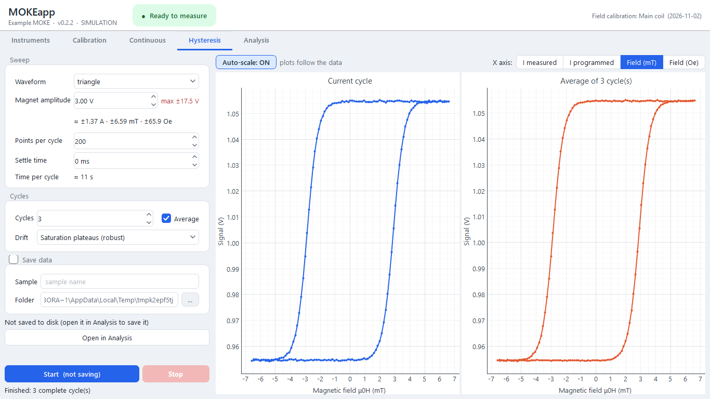
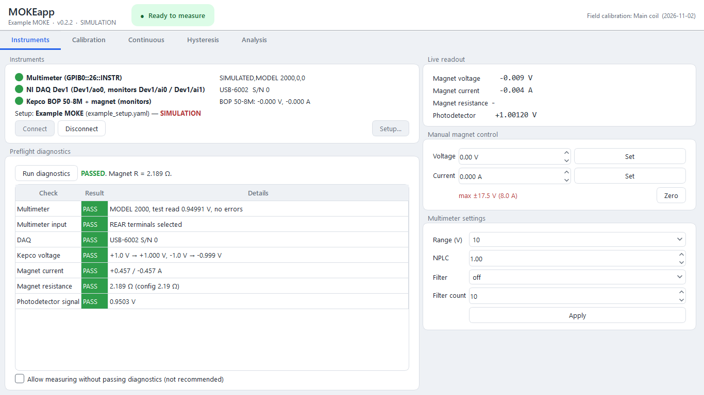
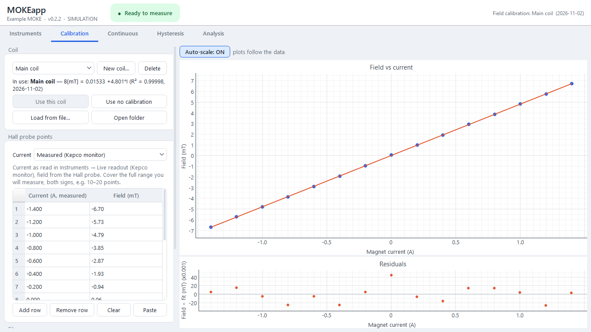
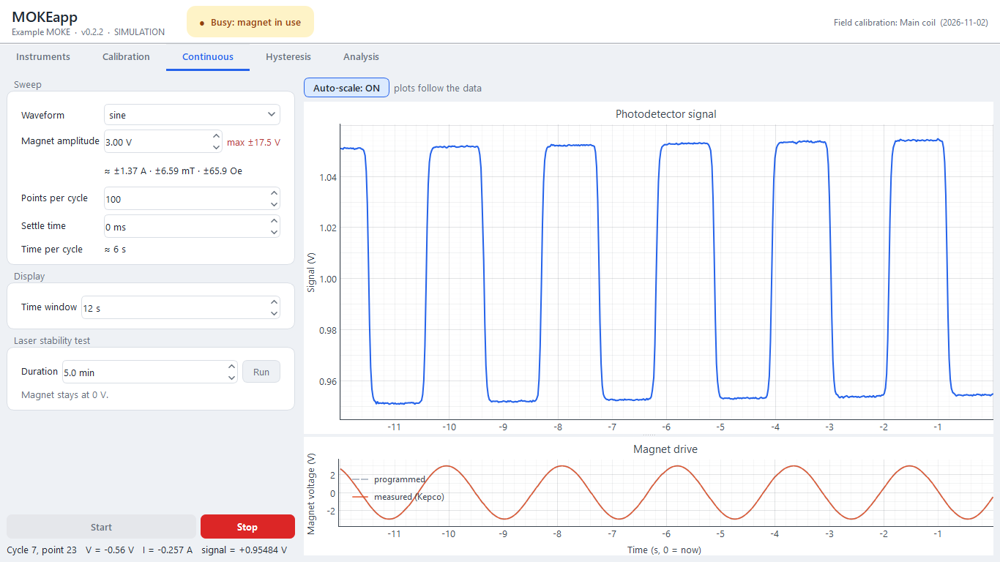
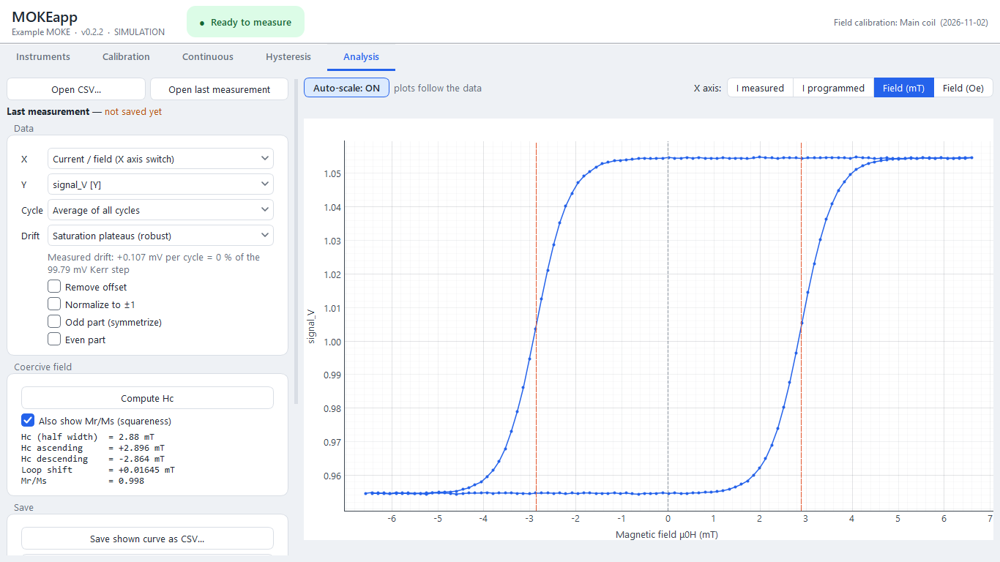

# MOKEapp

[](https://doi.org/10.5281/zenodo.23890037)

**Measure magnetic hysteresis loops with a longitudinal or polar MOKE: from the instruments to Hc, in
one desktop app.**

MOKEapp runs a magneto-optical Kerr effect magnetometer. A multimeter reads the photodetector, an NI
DAQ programs a bipolar supply (Kepco BOP) that drives the electromagnet, and the app sweeps the field
point by point, checks that everything behaves, saves self-describing CSV files and analyses the
loops. It works with any longitudinal or polar setup built this way.



## What it does

- **Measures loops point by point**, with triangle, sine or square sweeps. You choose the amplitude,
  points, settle time and cycles, and can average cycles. The magnet always goes back to 0 V.
- **Checks the hardware before measuring.** The diagnostics test the multimeter, the DAQ, the supply
  and magnet (gain, current, resistance) and the light on the photodetector.
- **Has safety built in.** Slew-limited ramps, voltage and current limits, a magnet-current watchdog and
  overheating detection.
- **Calibrates the field.** You type Hall-probe points, fit them (linear or polynomial) and save one
  file per calibration. The X axis can then be current, mT or Oe.
- **Analyses on demand.** Coercive field (Hc⁺, Hc⁻, shift), Mr/Ms, drift correction (simple or robust),
  offset removal, normalisation and odd/even symmetrisation. The processed curve can be saved.
- **Monitors the laser.** A stability test reports drift and noise, and a live strip chart shows the
  signal next to the magnet drive.
- **Finds the instruments for you.** The setup dialog lists what is connected: Keithley 2000 family,
  DMM6500/7510, 2100/2110 or any SCPI multimeter, and any NI-DAQmx device. The Kepco monitors and a
  Hall probe are optional.

| Instruments and diagnostics | Field calibration |
|---|---|
|  |  |
| **Live signal and magnet drive** | **Analysis: Hc, Mr/Ms, drift, symmetrisation** |
|  |  |

## What you need

- **Windows** with Python 3.12+ and, from ni.com, **NI-VISA**, **NI-488.2** (GPIB multimeters) and
  **NI-DAQmx**.
- A **multimeter** reading the photodetector (GPIB or USB, SCPI).
- An **NI DAQ** with one analog output; two more analog inputs if you wire the supply's current and
  voltage monitors.
- A **bipolar supply** programmable by voltage (e.g. Kepco BOP) driving the electromagnet.
- Optional: a **Hall probe** with an analog output, to calibrate the field or read it live.

## Install

```
git clone https://github.com/Manolo-Cardona-M/MOKEapp.git
cd MOKEapp
powershell -ExecutionPolicy Bypass -File install\setup_pc.ps1
```

The script checks the NI drivers, creates the Python environment with the tested package versions,
lists the instruments it can see and puts a **MOKEapp** icon on the desktop. The first time you open
MOKEapp it asks for your instruments (**Instruments → Setup...**). Without hardware you can try
everything with simulated instruments: `.venv\Scripts\python.exe main.py --sim`.

Tip: turn off Windows' *USB selective suspend* (Power Options → USB settings). Otherwise a USB DAQ or
GPIB adapter can fall asleep and return wrong readings or disconnect.

## A measurement, step by step

1. **Switch the laser on** and give it time. In **Continuous → Laser stability test**, run a few
   minutes with the magnet at 0 V. You get the drift (%/min), the noise and how much one loop would
   drift, to compare with your Kerr step.
2. **Instruments → Connect → Run diagnostics.** Measuring is enabled when the diagnostics pass. The live
   readout shows the magnet voltage, current and resistance and the photodetector.
3. **Calibration** (once per coil, or when the magnet changes):
   - put the Hall probe where the sample goes and zero it;
   - set currents in both directions (Instruments → Manual magnet control);
   - type current and field in the table, then **Fit** and **Save calibration**.
4. **Continuous:** run a sweep and adjust the optics (analyser angle, alignment) while watching the
   live signal. The plot below it shows the waveform actually sent to the magnet.
5. **Hysteresis:**
   - set the amplitude (soft films: ±0.5–1 V at the magnet is usually enough), points, settle time and
     cycles;
   - choose *Average* and the *Drift* correction;
   - tick **Save data** with a sample name if you want the files.

   The X axis switch shows measured current, programmed current, mT or Oe at any moment.
6. **Analysis:** **Open last measurement** (saved or not) or any CSV.
   - Choose cycles, drift correction, offset, normalisation or the odd part.
   - **Compute Hc**.
   - **Save shown curve** (with the processing written in its header) or **Export PNG**.

## Files

- **Measurements:** `data/<date>_<sample>_raw.csv` holds every point of every cycle, and
  `..._average.csv` the averaged loop. The `#` header lines are YAML: what each column means, the sweep
  settings, the calibration used and the instrument setup. Columns tagged `[X]` are field-axis
  candidates: `I_set_A` (programmed current), `I_magnet_A` (measured, with monitors), `B_mT`, `H_Oe`.
  `signal_V [Y]` is the Kerr signal.
- **Setups:** `config/<name>.yaml`, one per MOKE, written by the Setup dialog.
  `config/example_setup.yaml` is a commented example.
- **Calibrations:** `calibrations/<coil>_<date>.yaml`, one file per calibration; `active.yaml` is the
  one in use. **Load from file...** uses an older one again. Deleting moves files to
  `calibrations/deleted/`.
- **Logs:** `logs/session_<date>.log` for every session (diagnostics, runs, warnings, errors).

## Good to know

- **Without the supply's current monitors** the app uses the programmed current (V / nominal magnet R).
  The diagnostics warn that the magnet is not verified, unless a Hall probe is wired, and the current
  and overheating checks are off.
- **A field calibration remembers which current it was made with** (measured or programmed) and always
  converts with that one.
- **Calibrate with both signs of current.** A constant offset in B = a·I + b shifts every loop by b
  (tick *Force B = 0 at I = 0* if it is only the probe's zero). Iron-yoke remanence can be as large as
  the Hc of soft films; a Hall probe read live is the real fix.
- **Symmetrisation (odd part)** removes offsets, quadratic Kerr and artifacts that do not change sign
  with the field. It also centres the loop, so it hides a real exchange-bias shift: keep the raw data.
- Numbers always use a decimal point.

## Modify it

The code is plain Python (PySide6, pyqtgraph, PyVISA, nidaqmx):
- [docs/DEVELOPER.md](docs/DEVELOPER.md) explains the architecture and how to add a multimeter model, a
  DAQ or a CSV column;
- [CLAUDE.md](CLAUDE.md) lists the working rules of the project;
- [CHANGELOG.md](CHANGELOG.md) is the history.

Run the tests (all with simulated instruments, no hardware needed):

```
.venv\Scripts\python.exe -m pytest -q tests
```

To keep several PCs on the same version: `git pull` in the MOKEapp folder (with the app closed). Setups,
calibrations, data and logs belong to each PC and are not in git.

## Authors, licence and citation

Written by **Manolo Cardona** and **Paul Carvajal Morales**, Applied Magnetism and Spintronic Group,
Universidad Técnica Federico Santa María (2026). MOKEapp is a Python port, extended, of the LabVIEW
program that Paul Carvajal Morales wrote to run the group's MOKE.

Released under the [MIT licence](LICENSE): use, modify and share it freely, keeping the copyright
notice. If it helps your work, please cite it: Cardona, M. and Carvajal Morales, P., *MOKEapp*,
Zenodo, [doi:10.5281/zenodo.23890037](https://doi.org/10.5281/zenodo.23890037). This DOI always points to
the latest version; each version has its own DOI on Zenodo. See also [CITATION.cff](CITATION.cff) or
GitHub's "Cite this repository" button.

**Acknowledgements.** We thank Prof. Carlos García García for funding the development of this software.
The code was written with the help of Claude (Anthropic) as an AI coding assistant; design decisions,
testing on the instruments and validation of the results were done by the authors.
